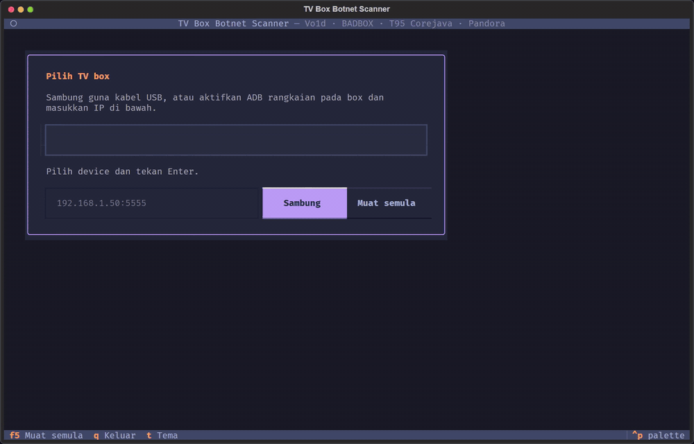

# tvbox-botnet-scanner

Scan dan buang malware botnet (Vo1d, BADBOX / T95 Corejava) pada Android TV box melalui ADB dari PC.



<sub>Demo guna **box simulasi** (`tools/demo_box.py`) dengan IOC sebenar dari Dr.Web dan Nokia Deepfield; tiada TV
box sebenar dijangkiti atau diubah. Versi MP4: [docs/demo/tvbox-scan-demo.mp4](docs/demo/tvbox-scan-demo.mp4).
Jana semula: `python tools/record_demo.py` (perlukan ffmpeg dan Edge atau Chrome).</sub>

> Guna hanya pada box milik sendiri atau yang anda diberi kebenaran untuk periksa.
> Lihat [Penafian](#penafian) sebelum guna `remove`.

## Cara paling mudah: suruh AI agent anda

Tampal ini ke dalam Claude Code, Codex, Cursor, Copilot atau Gemini CLI:

```
Pasang dan jalankan https://github.com/khuzaiiii/tvbox-botnet-scanner untuk periksa TV box saya
ada botnet atau tidak. Ikut AGENTS.md dalam repo itu langkah demi langkah.
TV box saya: <JENAMA DAN MODEL>
```

Agent akan ikut [AGENTS.md](AGENTS.md): semak model, pasang tool pada komputer, beri langkah tepat untuk
hidupkan debugging pada box anda, scan (baca sahaja), tunjuk pelan, dan hanya buang selepas anda kata "ya".
Prompt penuh (Melayu dan English): [PROMPT.md](PROMPT.md). Masalah biasa: [docs/TROUBLESHOOTING.md](docs/TROUBLESHOOTING.md).
Model yang disebut dalam laporan malware: [docs/DEVICES.md](docs/DEVICES.md).

Tool ini dipasang pada **komputer**, bukan pada TV. Komputer bercakap dengan box melalui ADB (Wi-Fi atau USB).

## Pasang sendiri

```bash
git clone https://github.com/khuzaiiii/tvbox-botnet-scanner
cd tvbox-botnet-scanner
powershell -ExecutionPolicy Bypass -File scripts\install.ps1   # Windows
sh scripts/install.sh                                           # macOS / Linux
```

Atau tanpa clone: `uv tool install "tvbox-botnet-scanner[ui] @ git+https://github.com/khuzaiiii/tvbox-botnet-scanner"`
(atau `pipx install` yang sama). Kemudian `tvbox-scan doctor` untuk semak.

## Cara kerja

```
PC (Python 3.10+) --ADB (USB / WiFi)--> TV box
  scan      : device props, packages, fail IOC, proses, sambungan TCP ke C2
  remove    : rancang tindakan -> dry-run -> backup ke PC -> laksana
  blocklist : eksport domain/IP C2 untuk Pi-hole / router
```

## Struktur

```
src/tvbox_scanner/
  adb.py              wrapper adb (shell, pull, kesan root adbd / su)
  models.py           Finding, Severity, ScanResult, Verdict
  iocs.py             loader iocs/*.json
  engine.py           jalankan semua scanner
  scanners/
    device.py         model box, test-keys, ro.secure/ro.debuggable
    packages.py       nama package + hash APK (--deep)
    files.py          fail dropper/payload, skrip boot yang diubah
    processes.py      proses berniat jahat yang sedang berjalan
    network.py        /proc/net/tcp{,6} -> IP C2
  remediation/
    actions.py        Action + tahap risiko (SAFE / MODERATE / DANGEROUS)
    planner.py        finding -> pelan (kill -> rm fail -> buang package)
    executor.py       dry-run lalai, backup sebelum padam, log actions.json
  report/             output teks, JSON, HTML
  blocklist.py        hosts / senarai domain / senarai IP
  data/iocs/          satu JSON untuk setiap famili malware (lihat README di dalamnya)
  ui/                 TUI Textual (pilih device, scan langsung, buang interaktif)
tools/update_iocs.py  tarik IOC dari ThreatFox
tests/                unittest + test UI headless dengan FakeAdb (tiada device diperlukan)
```

## UI interaktif

```bash
tvbox-scan ui                       # pilih device dari senarai / sambung guna IP
tvbox-scan -s 192.168.1.50:5555 ui  # terus ke scan
```

- **Pilih device:** senarai `adb devices`, dan boleh sambung guna IP.
- **Scan:** langkah scan dipapar secara langsung dengan spinner dan bilangan penemuan, jadual penemuan berwarna ikut tahap, panel evidence, dan banner keputusan. Kekunci: `s` scan, `D` deep scan, `r` buang, `w` simpan report HTML/JSON.
- **Buang:** pilih langkah satu per satu. Langkah `/SYSTEM` dikunci sehingga suis diaktifkan. Panel bawah tunjuk arahan dan path backup bagi langkah yang dipilih. Ada butang dry run, dialog pengesahan sebelum laksana, log langsung, butang reboot dan scan semula.
- **Keselamatan:** semua teks dari box dipapar sebagai teks biasa, tidak di-parse sebagai markup Textual.

## Guna (CLI)

```bash
pip install -e .
adb connect 192.168.1.50:5555        # atau sambung guna USB

tvbox-scan devices
tvbox-scan scan --html reports/box.html
tvbox-scan scan --deep                # hash setiap APK, lambat
tvbox-scan remove                     # dry-run: tunjuk apa yang akan dibuat
tvbox-scan remove --apply             # laksana, tanya setiap langkah
tvbox-scan remove --apply --allow-system   # termasuk padam fail dalam /system (perlukan root)
tvbox-scan restore backups/<masa>    # dry-run: tunjuk apa yang akan dipulihkan
tvbox-scan restore backups/<masa> --apply --allow-system   # undo remove (contoh: box bootloop)
tvbox-scan export-blocklist --format domains > badbox.txt
```

Kod keluar `scan`: 0 = tiada padanan HIGH, 1 = dijangkiti, 2 = ralat adb.

## Had penting

- **`NO_IOC_MATCH` tidak bermaksud bersih.** Scanner hanya kenal IOC yang ada dalam `src/tvbox_scanner/data/iocs/`.
- **Tanpa root**, `/data/system` dan sebahagian `/system` tidak kelihatan, dan app sistem hanya boleh
  di-disable untuk user 0. APK masih kekal dalam firmware.
- **Vo1d / BADBOX tertanam dalam firmware.** Factory reset tidak buang malware ini. Lepas `remove`,
  reboot dan scan semula. Kalau ia muncul semula, flash firmware bersih atau ganti box.
- Memadam fail dalam `/system` boleh menyebabkan bootloop. Sebab itu ia perlukan `--allow-system`,
  dan setiap fail di-backup dulu ke `backups/<masa>/`. **Backup tu mengandungi sampel malware.**
- Domain C2 tidak boleh dikesan dari box (tiada log DNS). Sekat di router atau Pi-hole guna `export-blocklist`.

## IOC

Fail IOC yang disertakan hanya mengandungi path dan nama yang disebut dalam laporan awam. Hash, domain dan IP
sengaja dibiarkan kosong. Isi dari sumber asal:

- Vo1d: <https://github.com/DoctorWebLtd/malware-iocs>
- T95 / Corejava: <https://github.com/DesktopECHO/T95-H616-Malware>
- BADBOX 2.0: laporan HUMAN Satori, ThreatFox (`THREATFOX_AUTH_KEY=... python tools/update_iocs.py --tag BADBOX --file src/tvbox_scanner/data/iocs/badbox2.json`)

## Rujukan projek

- [VortexisTV/Android-Proxy-Botnet-IOC-Scanner](https://github.com/VortexisTV/Android-Proxy-Botnet-IOC-Scanner)
- [Universal Android Debloater NG](https://github.com/Universal-Debloater-Alliance/universal-android-debloater-next-generation)
- [MVT](https://github.com/mvt-project/mvt)

## Test

```bash
python -m unittest discover -s tests -v
```

## Penafian

Tool ini disediakan **"seadanya", tanpa sebarang jaminan**, di bawah lesen MIT. Anda menggunakannya atas
risiko sendiri.

- `scan` hanya membaca. Tetapi `remove --apply` mengubah box, dan `--allow-system` memadam fail dalam
  `/system`. Ini boleh menyebabkan box **tidak boleh boot (bootloop)** atau hilang fungsi. Backup dibuat
  sebelum setiap pemadaman dan `tvbox-scan restore` boleh memulihkannya, tetapi tiada jaminan box yang
  sudah bootloop masih boleh dicapai melalui ADB.
- Keputusan `no_ioc_match` **bukan** bukti box bersih. Scanner hanya mengenal penunjuk (IOC) yang disenaraikan
  dalam `src/tvbox_scanner/data/iocs/`, yang diambil daripada laporan awam pada tarikh tertentu. Malware baharu
  atau yang diubah suai mungkin tidak dikesan.
- Malware dalam firmware (Vo1d, BADBOX) selalunya kembali selepas reboot. Penyelesaian yang pasti ialah
  firmware bersih daripada pengeluar atau box lain. Tool ini bukan pengganti kedua-duanya.
- Folder `backups/` mengandungi **sampel malware sebenar**. Jangan buka, jalankan atau kongsi.
- Hanya guna pada peranti milik anda atau yang anda diberi kebenaran untuk periksa. Pengguna bertanggungjawab
  mematuhi undang-undang tempatan.
- Nama jenama dan model disebut hanya kerana ia dinamakan dalam laporan keselamatan awam. Ini bukan dakwaan
  bahawa setiap unit model itu dijangkiti.

**English:** This software is provided "as is", without warranty of any kind (MIT licence). `remove --apply`
and especially `--allow-system` modify the device and can leave it unbootable. A `no_ioc_match` result does
not mean the device is clean. Use only on devices you own or are authorised to inspect, at your own risk.

## Lesen

MIT. Copyright (c) 2026 Khuzaii. Lihat [LICENSE](LICENSE).
